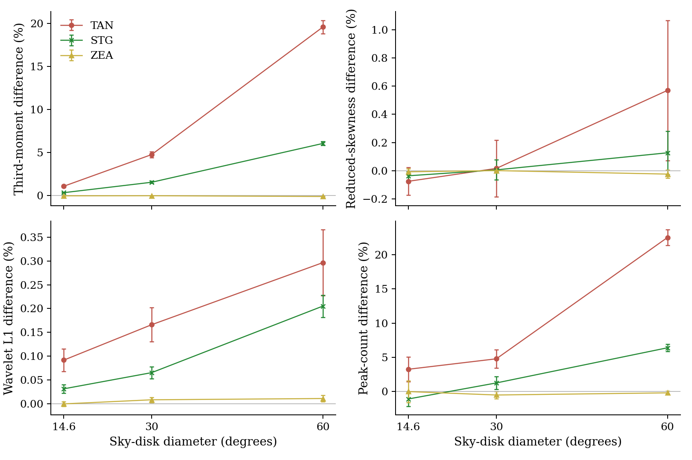

# Scalar lognormal projection control

Fixed central filter scales change the variance and third moment, but the third-moment response largely follows the variance.
At fixed central scale, reduced skewness S3 = M3/M2² shows no significant change in this toy field.
Most of the large raw-moment and peak shifts disappear after matching the mean angular filter scale.
These are signal-only filtering controls, not irreducible non-Gaussian biases or weak-lensing survey forecasts.

## Fixed central filter scale

Values are percent differences with paired Monte Carlo standard errors from 24 skies.
The reference filters on the sphere before projection; the measurement filters after projection with the same central angular width.
Reduced skewness is formed from ensemble-mean second and third moments, not by averaging the skewness of individual patches.

Bars are paired Monte Carlo errors and exclude the sampling drifts below.

| Chart | Sky-disk diameter | Variance | Third moment | Reduced skewness | Wavelet L1 | Peaks > 2σ |
|---|---:|---:|---:|---:|---:|---:|
| TAN | 14.6° | 0.58 ± 0.03 | 1.10 ± 0.13 | -0.08 ± 0.10 | 0.09 ± 0.02 | 3.26 ± 1.81 |
| STG | 14.6° | 0.19 ± 0.02 | 0.35 ± 0.06 | -0.04 ± 0.03 | 0.03 ± 0.01 | -1.08 ± 1.06 |
| ZEA | 14.6° | -0.01 ± 0.01 | -0.02 ± 0.04 | -0.01 ± 0.02 | -0.00 ± 0.00 | 0.00 ± 1.57 |
| TAN | 30° | 2.35 ± 0.08 | 4.77 ± 0.35 | 0.02 ± 0.20 | 0.17 ± 0.04 | 4.79 ± 1.33 |
| STG | 30° | 0.77 ± 0.03 | 1.56 ± 0.12 | 0.01 ± 0.07 | 0.07 ± 0.01 | 1.26 ± 0.93 |
| ZEA | 30° | -0.00 ± 0.01 | -0.01 ± 0.02 | 0.00 ± 0.01 | 0.01 ± 0.01 | -0.50 ± 0.50 |
| TAN | 60° | 9.03 ± 0.14 | 19.56 ± 0.78 | 0.57 ± 0.50 | 0.30 ± 0.07 | 22.50 ± 1.13 |
| STG | 60° | 2.92 ± 0.04 | 6.06 ± 0.22 | 0.13 ± 0.15 | 0.21 ± 0.02 | 6.40 ± 0.51 |
| ZEA | 60° | -0.03 ± 0.01 | -0.09 ± 0.04 | -0.02 ± 0.03 | 0.01 ± 0.01 | -0.18 ± 0.26 |

Errors use paired influence functions for the original summaries and a delete-one-whole-sky jackknife for reduced skewness; 20,000 whole-sky bootstrap resamples provide a cross-check.
The large third-moment shift must be quoted together with reduced skewness: it is not evidence for an independent non-Gaussian response beyond variance.
The reduced-skewness null is specific to this lognormal field and these filters; it is not a theorem that projection affects only variance.

## Mean angular-scale calibration

For each disk and chart, multiply both planar Gaussian widths by exp(⟨ln μ⟩/2), with a solid-angle average over that disk.
This matches the mean log angular smoothing scale; local magnification variation and shear remain.
It is a global scale calibration, not a map-level removal of projection.

The same 24 skies give the following residual differences on 60° disks.

| Chart | Sky-disk diameter | Variance | Third moment | Reduced skewness | Wavelet L1 | Peaks > 2σ |
|---|---:|---:|---:|---:|---:|---:|
| TAN | 60° | 0.07 ± 0.11 | 0.94 ± 0.63 | 0.79 ± 0.45 | -0.22 ± 0.05 | -0.31 ± 0.66 |
| STG | 60° | 0.02 ± 0.03 | 0.21 ± 0.19 | 0.17 ± 0.13 | -0.03 ± 0.01 | 0.06 ± 0.46 |
| ZEA | 60° | -0.03 ± 0.01 | -0.09 ± 0.04 | -0.02 ± 0.03 | 0.01 ± 0.01 | -0.18 ± 0.26 |

Wavelet L1 is the exception: mean-scale calibration does not remove most of its shift.
TAN 60° retains a -0.22 ± 0.05% wavelet response with its sign reversed.
The fixed-scale value partly cancels a paired mean-scale term of +0.52 ± 0.05% against that residual.
These paired errors use the same reference and skies, not independent subtraction errors.
Calibrated reduced skewness is a separate, marginal measurement; the fixed-scale null must not be used to assert that every calibrated statistic is zero.
ZEA has μ=1, so its scale factor is exactly one and its calibrated row repeats the same measurement rather than adding evidence.

The unit-central-scale percentages are therefore not invariant properties of a chart or statistic.
Calibrated residuals describe this chosen mean-scale matching rule; no universal residual law is established.

## Model and estimator

The field is exp(G − 0.7²/2) − 1, with an isotropic Gaussian log-field of rms 0.7.
Its spectrum is proportional to (ℓ + 20)^−1.5 exp[−ℓ(ℓ+1)(0.25°)²], with monopole and dipole zero.
The spherical Gaussian widths are sigma 0.5° and 1°; their difference defines the wavelet.
Wavelet L1 is the mean absolute amplitude, not a Morlet scattering transform.
The 14.6°, 30° and 60° footprints are spherical disks, not DES square patches.
Area moments use solid-angle weights and subtract each patch mean.
Peaks exceed twice the full-sphere reference smoothed rms and are maxima within a fixed ±0.3° chart square.
That neighbourhood suppresses interpolation-scale duplicates and is part of this estimator.
The peak threshold is held fixed between the spherical and planar arms, including after scale calibration.
Six reference Gaussian-sigma overscan excludes map-edge effects for both filter normalizations.
The paired raw-moment equality is a construction identity, since both arms use the same raw array; it is not an empirical test of invariance.

Independently sampled raw scalar moments agree across charts on the matched disk to the following fractional spreads.

| Diameter | Raw variance spread (%) | Raw third-moment spread (%) |
|---|---:|---:|
| 14.6° | 0.033 | 0.201 |
| 30° | 0.019 | 0.086 |
| 60° | 0.030 | 0.056 |

The 14.6° peak percentages involve only a few count changes across all 24 skies.

| Chart | Reference count | Planar count | Net change |
|---|---:|---:|---:|
| TAN | 92 | 95 | +3 |
| STG | 93 | 92 | -1 |
| ZEA | 92 | 92 | +0 |

## Sampling controls

Four identical-alm seeds repeat at doubled HEALPix and/or chart sampling.
The baseline is Nside 512, 0.1° pixels and fixed ℓmax=1024; controls use Nside 1024 and/or 0.05° pixels.
All listed drifts are maxima of absolute paired four-seed differences over the nine chart/footprint configurations, in percentage points.
They are numerical regression diagnostics, not independent physical bounds.

| Statistic | Sphere only | Plane only | Both | Calibrated, both |
|---|---:|---:|---:|---:|
| smooth_variance | 0.050 | 0.017 | 0.052 | 0.018 |
| smooth_third | 0.152 | 0.124 | 0.153 | 0.122 |
| reduced_skewness | 0.112 | 0.115 | 0.112 | 0.112 |
| wavelet_l1 | 0.089 | 0.005 | 0.088 | 0.005 |
| peaks_gt_2sigma | 2.778 | 1.408 | 2.778 | 2.740 |

The calibrated TAN 60° wavelet shift is stable under doubled sampling on the four control skies: -0.179% → -0.177%.
This is evidence that the residual is not just the observed interpolation drift; it is still not a continuum value or survey bound.
The fixed-scale TAN wavelet shift has a much larger sampling drift and should not be quoted as a precision result.
Small ZEA shifts are not continuum-accuracy measurements or upper limits.
The small-disk peak changes remain unresolved at the sampling-control level.

## Interpretation and inference

At fixed central chart scale there is no universal shear-only law: STG has g=0 yet its smoothed moments change.
Locally, magnification changes a chart kernel’s sky width by δ ln sigma = −½ ln μ.
For the monotonic second and third moments here, a smoothing-scale derivative times ⟨ln μ⟩ explains the leading response.
The second-order-in-radius magnification response versus fourth-order g² comparison assumes unit chart scale at the tangent point; a global scale matching removes most of it.
It must not be presented as an irreducible distortion that survives scale calibration.
The independent Opus scale scan found wavelet L1 near a stationary point of its response in this toy spectrum; its small fixed-scale shift partly cancels the surviving residual and is not evidence of general wavelet robustness.
No quantitative universal wavelet response law is established.
For homogeneous isotropic fields and local isotropic filters, pure fixed-determinant shear can have a leading quadratic response with a field- and statistic-dependent coefficient.
Continuous unfiltered scalar values and extrema are invariant under coordinate relabelling on a matched footprint with the correct measure.

No largest survey-safe patch size is established.
Shape noise, masks, source distributions, cosmological derivatives, multiscale covariance and spin-two mass mapping are absent.
The stored signal-only single-patch scatter is not a realistic survey error bar.
A dedicated weak-lensing analysis is needed for survey-error tolerances, and this disk/lognormal/Gaussian example does not reproduce DES scattering patches.

Jeffrey et al. (arXiv:2403.02314, §6.3; bibliography key jeffrey25) apply the same flattening to data and simulations and distinguish correct forward modelling from potentially suboptimal compression.
A shared deterministic transformation removes this particular data/model mismatch only when masks, noise, filtering and spin transport are included consistently at every parameter value.
These toys do not demonstrate calibrated cosmological posteriors or recover information discarded by compression.

## Suggested manuscript scope

The useful result is a filtering-scale calibration example with a reduced-skewness null, not a discovery of an extra higher-order bias.
If retained, put it after the scalar-versus-spin-two footprint discussion and quote both raw and normalized moments.
The conclusion should reserve survey-error bounds for a dedicated study.

On scalar lognormal skies, applying a fixed central-width Gaussian filter after projection rather than on the sphere changes the third moment by \ngTANThirdLarge\ on a $60^\circ$ gnomonic disk, but the reduced skewness $S_3=M_3/M_2^2$ is consistent with zero shift (\ngTANReducedSkewnessLarge\ with jackknife error \ngTANReducedSkewnessLargeError).
Matching the mean angular filter scale leaves a third-moment shift of \ngCalTANThirdLarge\ (error \ngCalTANThirdLargeError), whereas the mean absolute amplitude of a $0.5^\circ$ minus $1^\circ$ Gaussian wavelet retains a shift of \ngCalTANWaveletLarge\ (error \ngCalTANWaveletLargeError).
The large raw third-moment shift alone does not establish an independent higher-order bias, and mean-scale calibration does not remove every statistic’s response.
Projection therefore belongs in the simulations and filtering convention of a higher-order analysis \citep{jeffrey25}; realistic safe-patch bounds require a dedicated weak-lensing study.

To use the macros, input paper/beyond_two_point_numbers.tex and run analysis/paper_numbers.py --beyond-two-point-only after editing main.tex.

## Reproduction

`lc run --executor htcondor --profile htcondor9 beyond_two_point beyond_two_point_resolution beyond_two_point_calibrated beyond_two_point_calibrated_resolution -u highell`
`bash env.sh python3 analysis/check_beyond_two_point.py --results`
`bash env.sh python3 analysis/beyond_two_point_report.py`
`~/.local/share/uv/tools/lightcone-cli/bin/python analysis/check_beyond_two_point_provenance.py`

The provenance gate checks canonical hashes, all unit hashes, gathered bytes and stage contents against unit git pins.
It runs lc verify on an isolated unchanged four-output slice because the CLI has no output selector.
Raw measurements and manifests live under results/highell/beyond_two_point*; summary.json holds all cells, bootstrap errors, counts and controls.
