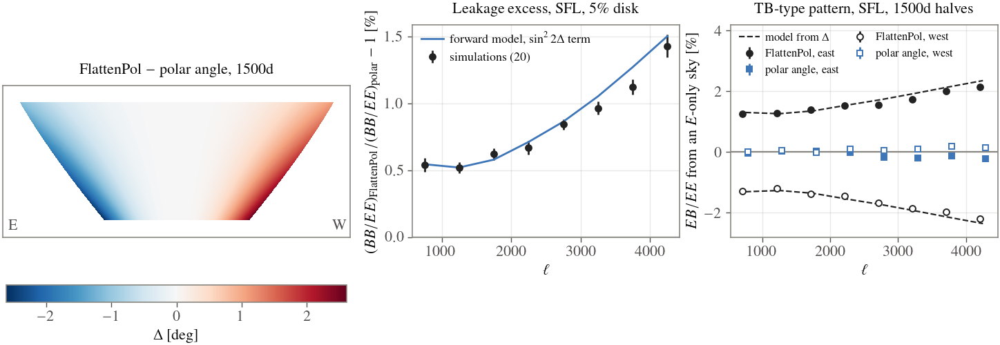

# FlattenPol: rotate by the polar angle of the projection Jacobian

## Summary

`maps.flatten_pol` rotates Q/U by the average of the angle of grid "north" and the angle of grid "east",

```
rot = atan2(-da/dx, da/dy) + atan2(-dd/dy, -dd/dx)
```

That is not the rotation the projection applies. Locally a projection is a linear map J, and its polar decomposition J = R S splits it into a rotation R and a symmetric stretch S. Flattening has to remove R; S is the projection's shear, and no rotation can remove it. The averaged angle equals R's angle only where the projection is conformal or its stretch axes lie along the grid axes or diagonals. Elsewhere it misses by Δ ≈ (g²/2)|sin 4β|, with g = (s₁−s₂)/(s₁+s₂) the local shear and β the angle of the stretch axes to the grid. Δ is a position-dependent polarization rotation added by the pipeline.

R's angle has a closed form in the same four derivatives, so the fix is a few lines:

```
rot = 2 atan2(-dd/dx - cos(d) da/dy,  dd/dy - cos(d) da/dx)     (pixel derivatives over pixel size)
```

## Why this angle, and why the average misses it

For a 2×2 Jacobian J = [[a, b], [c, d]] with det J > 0, R(ψ)ᵀJ is symmetric exactly when (a + d) sin ψ = (c − b) cos ψ. Taking the branch with positive trace makes the symmetric factor positive definite, so ψ_R = atan2(c − b, a + d) is the polar rotation. FlattenPol works with the inverse map (sky by pixel), and the inverse's polar rotation is R⁻¹, so the same formula applies to those derivatives once both axes are measured in angle (RA derivatives times cos δ). The result is the line above.

There is a compact way to see the difference. Write the two gradients FlattenPol already computes as complex numbers, n = ∂θ/∂x + i ∂θ/∂y (θ the colatitude) and e = sin θ (∂φ/∂y − i ∂φ/∂x). Then

- polar angle: ψ_R = arg[ i (n − e) ]
- FlattenPol:  ψ   = arg[ i (n/|n| − e/|e|) ]

FlattenPol's angle is the same expression with both gradients normalised to unit length. That throws away their relative length, and that length is exactly what distinguishes a rotation from a shear whose axes are off the grid. The two angles agree when |n| = |e| or n ⟂ e: the stretch axes lie along the grid diagonals or along the grid axes, the zeros of sin 4β. (FlattenPol also doesn't need cos δ, because each atan2 sees only one coordinate.) Flattening by ψ_R leaves R(ψ_R)ᵀJ symmetric to machine precision.

## Evidence



Simulations: 20 unlensed CMB realizations, Q/U synthesized at Nside 8192 and projected to a 2′ SFL grid (`healpix_to_flatsky`, then the stock `flatten_pol`), from the pol_project highell run. Each map was unflattened with `flatten_pol(invert=True)` and reflattened with ψ_R, so the two versions share the same sky.

- **Left:** Δ = FlattenPol − polar over SPT's 1500d field in SFL. It is odd about the central meridian and reaches 2.6° at the field's southern corners.
- **Middle, leakage:** on a 5% disk, FlattenPol's BB/EE is higher than the polar-angle BB/EE by 0.81 ± 0.02% (mean over 20 sims, 1000 < ℓ < 4000). The forward model of the projection attributes 0.83% to Δ (a sin² 2Δ term). That excess is the "BB excess over the shear prediction": with ψ_R, BB/EE is set by the shear S alone. Above ℓ ≈ 3500 the simulations sit up to ~12% of the effect below the model.
- **Right, TB pattern:** an E-only sky picks up EB from Δ (the spin-2 twin of TB/TE: a frame rotation by Δ turns E into B by sin 2Δ). Over the full field the pattern cancels by symmetry, but on either half it does not. On the eastern half FlattenPol gives EB/EE = 1.33 ± 0.06% (predicted from Δ: 1.31%) and the polar angle gives 0.02 ± 0.06%. On the same half, TB/TE from a T+E sky is predicted at 1.6%. The pattern grows with ℓ because the damping tail gives more weight to the high-shear corners, where |Δ| is largest. The dashed model, which reads the spectrum at the sheared wavenumber, reproduces that growth.

For SFL on the full 1500d field, the projection's leakage is BB/EE ≈ 7.0%, and Δ adds 0.9% of that (forward model; 0.85 ± 0.02% from the same simulations' pseudo-spectra). Zenithal projections carry much less: at most 0.03% of the leakage on the 5% disk, and |Δ| ≤ 0.21° (SIN) over RA −60…60°, dec −80…−35° about a tangent point at (0°, −56°). BICEP (CAR) and STG are unchanged: BICEP's Jacobian is diagonal on the grid, and STG is conformal.

## Checks

- ψ_R = atan2(c − b, a + d) agrees with `scipy.linalg.polar` to ≤ 4e-16 rad at 4000 random points of each of SFL, SIN, STG, ZEA and BICEP (RA −60…60°, dec −80…−35°).
- ψ_R built from `xy_to_angle` gradients, with exactly the arithmetic of the patch, matches the Jacobian's polar angle to ≤ 3e-6°, against Δ up to 4.3° for the stock angle (SFL, g = 0.46).
- The patched `flatten_pol` (built from upstream master) reproduces the Python polar-angle flattening on real maps to 2e-10 (relative), for all five projections; for STG and BICEP it reproduces the stock output to the same precision.

## Notes for review

- The patch changes the output of `flatten_pol` for every projection except the conformal and grid-aligned ones. Maps flattened with the old angle and unflattened with the new one, or the reverse, will not round-trip. `invert=True` uses the same angle and still inverts exactly.
- The change scales the derivatives by `xres`/`yres`, so non-square pixels are handled correctly. The stock angle is not scale-covariant in that case.
- Cost: one extra `PixelToAngle` per pixel.

Derivation, numbers and figure script: `analysis/polar_flatten.py` in pol_project; the patched-build check is `check_patched_build.py` next to this file. Patch: `flattenpol-polar-angle.diff` (against `maps/src/maputils.cxx` on master 7ddcc2a92).
