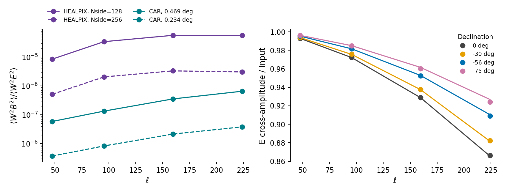

# Spherical transforms on HEALPix and CAR

Point sampling and finite pixel averaging give different answers.
A band-limited, zero-B sky sampled at pixel centres reconstructs without intrinsic E/B leakage on either grid, to the numerical accuracy of the tested spherical transforms.
Explicit pixel averaging produces a small, nonzero B component, even when every subpixel polarization is correctly parallel transported to the parent centre.
A spherical transform avoids the paper's flat-projection remapping; it does not eliminate finite-pixel or aliasing effects.

## Measurement and scope

`src/stages/spherical_grid_test.py` uses three common white E-only skies with `C_ell=1`, `2 <= ell <= 256`, HEALPix Nside 128 and 256, and full-sky Fejer-1 CAR grids of 384x768 and 768x1536 pixels.
The CAR spacings are 0.46875 and 0.234375 degrees in both chart coordinates.
HEALPix uses healpy's spherical spin-2 transforms with eight residual-refinement iterations; CAR uses ducc0's exact Fejer-1 analysis/synthesis.
There is no interpolation between the grids and no flat Fourier E/B split.

Finite pixels are quadratures over 4x4 or 8x8 subpixels, with equal-area weights for HEALPix and sin(theta) weights for CAR.
Both the coordinate-component average and the parallel-transported average are retained.
The latter transports the subpixel theta basis by the minimal three-dimensional rotation taking its radial vector to the parent radial vector.
`analysis/check_spherical_grid.py` checks that rotation against an independent great-circle bearing formula.

The statistic first reconstructs global spherical E and B, filters each into a multipole band, synthesizes scalar E/B maps, then integrates their squared amplitudes with the production 1500d field's squared C2 mask (RA -50 to +50 degrees, declination -70 to -42 degrees, 2.5-degree taper).
**This isolates intrinsic grid/pixel leakage; it is not a cut-sky estimator test or a bound on mask-induced leakage.**
The white spectrum makes pixel effects visible; these numbers are not a CMB/beam-specific production prediction, nor a universal leakage coefficient of a grid.
A pixel operator that varies across the sky also couples input multipole bands, so B in one output band need not originate in that same input band.

All 15 units ran through `lc run --executor htcondor --profile htcondor9 -u highell` and gathered into `results/highell/spherical_grid_test` and `spherical_grid_alias_test`.
Focused `lc verify -u highell` on those two additive outputs passed, and all 15 unit directory hashes matched their worker manifests.
The focused verification excludes the project's unrelated large outputs; no claim is made about the whole universe's integrity.

## Point samples and finite pixels

Across the four tested bands from ell=32 to 256, all point-sample footprint B/input-E power ratios are below 2e-22 (HEALPix Nside 128) or 2e-28 (CAR).
Nside 256 HEALPix reaches below 6e-32.
These are observed numerical residuals in this roundtrip, not statistical confidence bounds.

For the highest band, ell=192 through 256, the 8x8 parallel-transported pixel averages give:

| Grid | B power / input E power | B power / output E power | E cross-amplitude / input |
|---|---:|---:|---:|
| HEALPix Nside 128 | (4.16 +/- 0.63)e-5 | 5.71e-5 | 0.85239 +/- 0.00219 |
| HEALPix Nside 256 | (2.83 +/- 0.41)e-6 | 3.06e-6 | 0.96128 +/- 0.00060 |
| CAR 0.46875 degrees | (5.42 +/- 0.15)e-7 | 6.56e-7 | 0.90808 +/- 0.00098 |
| CAR 0.234375 degrees | (3.63 +/- 0.11)e-8 | 3.80e-8 | 0.97639 +/- 0.00026 |

The quoted errors are standard errors across three skies, not a convergence error.
Changing 4x4 to 8x8 subpixels raises B power by about 8-10% in this band.
A leading 1/factor^2 extrapolation raises the 8x8 powers by another 2.4-3.0%; it is an extrapolation, not a third measured quadrature.
Doubling the grid resolution reduces B power by about fifteen, consistent with a leading pixel-area effect on the polarization amplitude.
The coordinate-component averages produce more B in this band: 4.91e-5 versus 4.16e-5 on coarse HEALPix, and 8.40e-7 versus 5.42e-7 on coarse CAR, normalized to input E power.
Correct transport matters, but does not remove finite-pixel mixing.

The spatially varying/anisotropic pixel operator, centre-versus-centroid displacement, and sampling of the resulting non-band-limited field are not separately isolated by this experiment.
It would be too strong to attribute every residual specifically to window anisotropy.

## CAR window and pixell

For a small CAR cell with coordinate widths Delta_delta and Delta_alpha, its tangent-plane sides are Delta_delta and cos(delta) Delta_alpha.
The parallelogram response is

    W(ell, chi; delta) = sinc[ell Delta_delta cos(chi)/2]
                       sinc[ell cos(delta) Delta_alpha sin(chi)/2],

where sinc(x)=sin(x)/x.
For equal chart widths Delta, the orientation-averaged amplitude begins as

    <W>_chi = 1 - ell^2 Delta^2 (1 + cos(delta)^2)/48 + O((ell Delta)^4).

Equivalently, with physical pixel area A and g=(1-cos(delta))/(1+cos(delta)), the coefficient is A/24 times (1+g^2)/(1-g^2), exactly the paper's parallelogram second moment.
The prediction is evaluated with sqrt(ell(ell+1)), direction averaging, band weights 2ell+1, and latitude-area weighting.
For comparison to finite quadrature, each sinc factor is divided by the corresponding subpixel sinc; this keeps the finite 8x8 quadrature and the continuum prediction distinct.

For the coarse grid's highest band, E cross-amplitudes in six-degree latitude strips are 0.86623, 0.88243, 0.90918 and 0.92430 at declinations 0, -30, -56 and -75 degrees.
The local parallelogram predictions are 0.86568, 0.88172, 0.91041 and 0.92689.
The largest absolute amplitude difference across all tested bands and these regions is 0.00259.
The three-sky finite-region directional sampling, curvature corrections, and nonlocal E/B reconstruction are not separated in that difference; agreement is at roughly 0.3%, not 1e-4.
The measured declination dependence is no longer merely an inference.

An actual `pixell==0.32.9` check verified that `enmap.calc_window(shape, order=0)` returns sinc(pi*f_y) and sinc(pi*f_x), the same top-hat response in chart Fourier coordinates.
Changing variables from chart wavevector to physical tangent-plane wavevector yields exactly the above cosine-declination dependence.
Its interpolation order matters: order 1 gives the bilinear rather than top-hat window.
`curvedsky.alm2map` followed by `curvedsky.map2alm` on a Fejer-1 CAR map preserves the supplied alms to floating-point accuracy and applies no pixel-average window automatically.
Thus a CAR grid has no universal smoothing window independent of the mapmaking/sampling operation.
The optional pixell regression needs pixell on PYTHONPATH; production stages require only CVMFS healpy and ducc0.

## HEALPix global window versus footprint

At Nside 128 and ell=192 through 256, the measured full-sky E cross-amplitude is 0.86386, versus 0.86440 from the global polarization `hp.pixwin(128)/hp.pixwin(1024)` response.
On the 1500d footprint it is 0.85239.
At Nside 256 the full-sky values are 0.964536 versus 0.964528 predicted, while the footprint gives 0.961275.
The denominator window is the finite-subpixel correction: the subpixel maps are point samples, not already averaged pixels.
A global HEALPix window therefore describes the all-sky average much better than this southern footprint; it does not encode all spatial variation.

Hall & Tessore (2025), arXiv:2501.08718, **equation (B.5)** gives precisely this distinction.
Its scalar second-moment term varies by pixel, and its spin-2 inertia terms retain pixel anisotropy.
The text below that equation explicitly says that neither the scalar spatial variation nor the spin-weighted inertias are included in the standard HEALPix window.
These simulations agree with that qualitative conclusion; they do not validate every coefficient in that perturbative expression or establish a new pixel-window theorem.

## Out-of-band injection

`src/stages/spherical_grid_alias_test.py` extends a white zero-B sky to ell=512 and compares it with the same realization cut to 256 before synthesis.
Both are reconstructed only to 256 on the coarse grids.
Taking their reconstructed-alm difference isolates the contribution from input modes above the analysis cutoff.
In the highest output band the B/input-inband-E power ratios of that difference are:

| Grid operation | Aliased B / input in-band E |
|---|---:|
| HEALPix point sampling | 0.12390 |
| HEALPix finite averaging, 4x4 | 0.01992 |
| CAR point sampling | 3.55e-5 |
| CAR finite averaging, 4x4 | 6.46e-6 |

Finite averaging suppresses this particular alias injection but does not eliminate it.
The imposed white tail and different sampling geometries make these stress tests, not an equal-resolution ranking for an observed CMB map.
Increasing HEALPix inverse refinement from eight to sixteen iterations changes the extended-sky point-reconstruction alms by only 3.6e-11 in relative norm for seed zero, so the large HEALPix alias signal is not an unconverged inverse.

## Paper changes supported

Keep the claim that a spherical transform evaluates modes at true sky positions and therefore introduces no flat-projection remapping.
Qualify any statement that the grid's shear "only sets a pixel window": a common *spatially invariant* scalar filter cannot mix E/B, but a position-dependent finite-pixel operator can.
Replace the CAR window's inferred declination dependence with the local rectangular-window formula and measured confirmation, while stating the assumed top-hat averaging.
Point-sample numerical residuals must be labelled full-sky-reconstruction tests selected on a footprint, not a survey cut-sky leakage bound.
Cite Hall & Tessore for effects omitted by a scalar global pixel-window correction.
No edits to `paper/main.tex` or hard-typed production macros are made here.

## Reproduction and figure

Run `bash env.sh python3 analysis/spherical_grid_report.py` after materializing both additive outputs.
It fails if units are missing, the point-sample null is lost, or the CAR window trend disagrees by more than 0.004 in amplitude.
It writes `analysis/figures/spherical_grid_summary.json` and `spherical_grid_tests.{png,pdf}`.
Run `bash env.sh python3 analysis/check_spherical_grid.py`, adding `--pixell` when pixell 0.32.9 is available.

Left: intrinsic B/output-E variance on the 1500d footprint for 8x8 parallel-transported pixel averages, averaged over three white E-only skies.
Right: CAR E cross-amplitude in latitude strips (points), with the local rectangular-window prediction (lines), for the coarse grid.
The numerical point-sample floors are omitted from the logarithmic panel.
The plot is a diagnostic, not an additional proposed main-paper figure.
